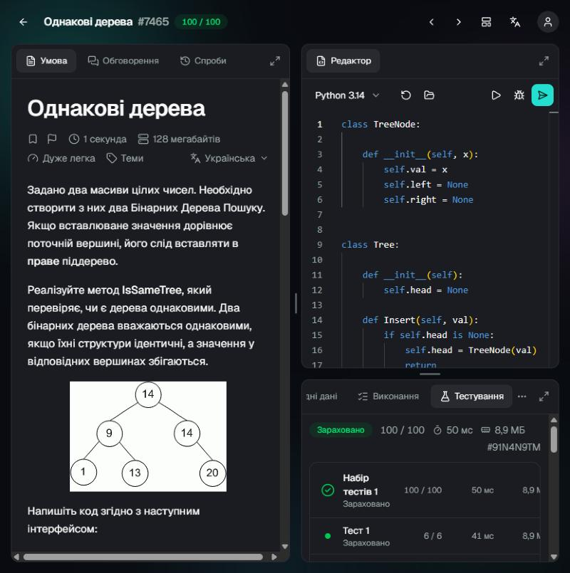
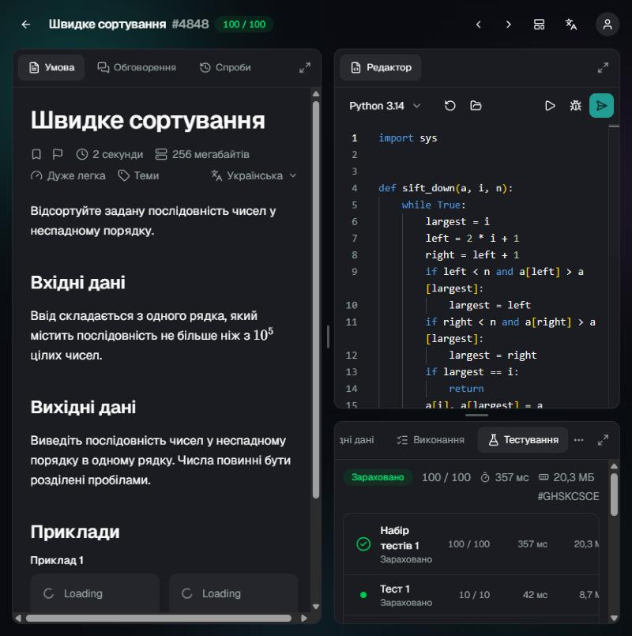
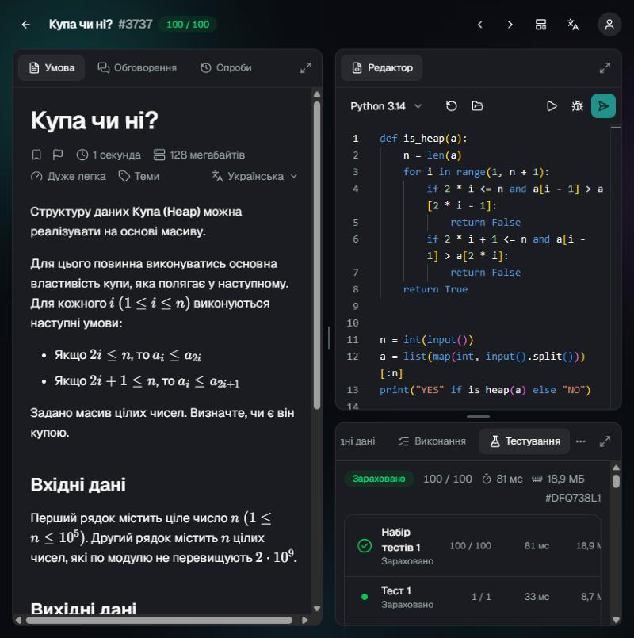
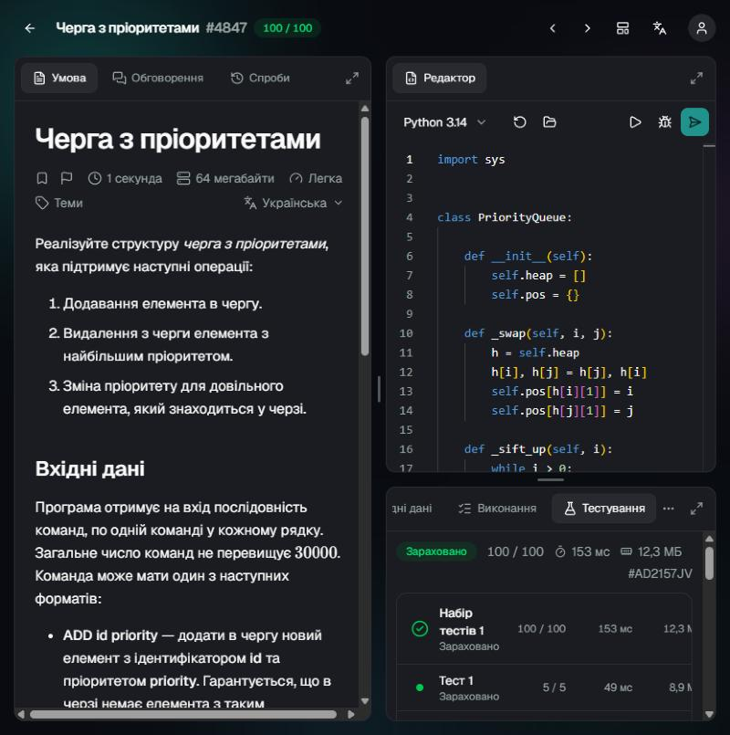

# Алгоритми і структури даних. Лабораторні роботи 17, 19. Бінарні дерева, двійкова купа, пріоритетна черга

| Задача | Eolymp | Код | Результат |
|---|---|---|---|
| 17.6. Родовідне дерево | [2242](https://eolymp.com/uk/problems/2242) | [t17_06_e2242.py](t17_06_e2242.py) | 100% |
| 17.7. Однакові дерева | [7465](https://eolymp.com/uk/problems/7465) | [t17_07_e7465.py](t17_07_e7465.py) | 100% |
| 19.2. Швидке сортування (heap sort) | [4848](https://eolymp.com/uk/problems/4848) | [t19_02_e4848.py](t19_02_e4848.py) | 100% |
| 19.3. Купа чи ні? | [3737](https://eolymp.com/uk/problems/3737) | [t19_03_e3737.py](t19_03_e3737.py) | 100% |
| 19.4. Черга з пріоритетами | [4847](https://eolymp.com/uk/problems/4847) | [t19_04_e4847.py](t19_04_e4847.py) | 100% |

---

## 17.6. Родовідне дерево
Дерево — бінарне дерево пошуку, реалізоване рекурсивно (вузол `TreeNode` з посиланнями на ліве і праве піддерева). Листки знімались знизу вгору, тому, вставляючи літери рядків у зворотному порядку (від останнього рядка до першого), відновлюємо початкове дерево. Відповідь — прямий обхід (корінь, ліве піддерево, праве піддерево).

## 17.7. Однакові дерева
Два бінарних дерева пошуку будуються вставкою (рівні значення — у праве піддерево). Метод `IsSameTree` рекурсивно порівнює вузли: дерева однакові, якщо збігаються значення в коренях, а також ліві та праві піддерева.

## 19.2. Швидке сортування
Пірамідальне сортування (heap sort): з масиву будуємо max-купу просіюванням вниз від середини до початку, потім n−1 разів міняємо корінь (максимум) з останнім елементом купи і відновлюємо купу. Складність O(n log n).

## 19.3. Купа чи ні?
Перевіряємо основну властивість купи: для кожного i виконується aᵢ ≤ a₂ᵢ і aᵢ ≤ a₂ᵢ₊₁ (якщо ці елементи існують).

## 19.4. Черга з пріоритетами
Пріоритетна черга на основі двійкової max-купи. Додатково зберігається позиція кожного ідентифікатора в купі, тому зміна пріоритету виконується за O(log n): змінюємо значення і просіюємо елемент вгору або вниз. ADD і POP — стандартні операції купи за O(log n).

